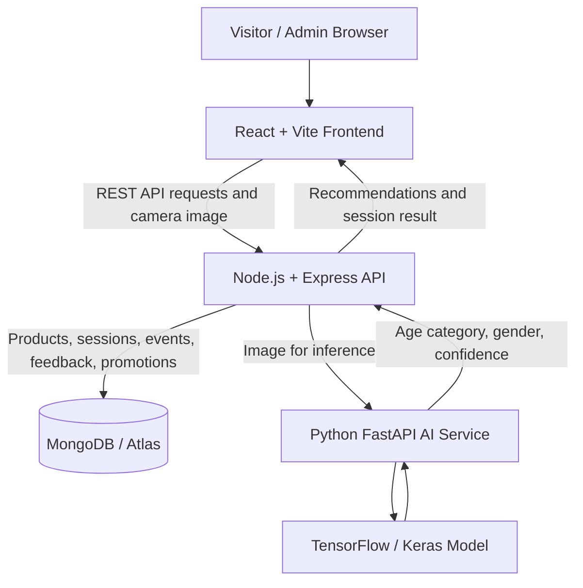

# AI Interactive Shopping Mall System

An AI-powered interactive mall kiosk that estimates a visitor's broad age group and gender from a camera image, then recommends matching products from a mall catalogue. The project combines a React kiosk interface, an Express API, a Python/TensorFlow inference service, and MongoDB-backed product and session data. It also includes an administrative dashboard for managing the catalogue and reviewing system activity.

**Live demo:** [Open the Smart Mall Screen](https://ai-shopping-mall-system-fyp.vercel.app/) · [Admin Login](https://ai-shopping-mall-system-fyp.vercel.app/admin/login)  
**Backend health:** [Node.js API](https://ai-shopping-mall-system-fyp.onrender.com/health) · [AI service](https://ai-shopping-mall-system-api.onrender.com/health)

> **Project status:** Final Year Project / demonstration system. The deployed services use free hosting, so the first request after a period of inactivity may take longer while a service starts.

## Table of Contents

- [Overview](#overview)
- [Features](#features)
- [Architecture](#architecture)
- [Technology Stack](#technology-stack)
- [Repository Structure](#repository-structure)
- [How Recommendations Work](#how-recommendations-work)
- [Run Locally](#run-locally)
- [Environment Variables](#environment-variables)
- [API Overview](#api-overview)
- [Deployment](#deployment)
- [Troubleshooting](#troubleshooting)
- [Privacy and Limitations](#privacy-and-limitations)
- [License](#license)

## Overview

The Smart Mall Screen is designed as a browser-based kiosk for a shopping mall. A visitor starts the experience, grants camera permission, and provides a camera image for inference. The AI service predicts one of four age categories—`Kid`, `Young`, `Adult`, or `Senior`—and a binary gender label—`Male` or `Female`. The backend then looks up active catalogue items whose targeting rules match the prediction and the selected weather condition.

The application also includes a protected admin area for product management, event management, promotions, feedback, and analytics. It is built as a multi-service application so the frontend, business API, and machine-learning inference service can be developed and deployed separately.

## Features

### Interactive kiosk

- Camera-based visitor flow with a processing/loading state.
- AI-generated age-category and gender estimates.
- Product recommendations matched against catalogue targeting rules.
- Product information such as category, price, image, and physical store location.
- QR-code support in the product interaction flow.
- Promotional game flows and generated discount codes.
- Visitor feedback ratings and session activity tracking.
- Weather-aware filtering when a weather condition is supplied; `All` acts as a general fallback.

### Admin dashboard

- JWT-based admin login.
- Product catalogue management: list, search, filter, create, update, and deactivate products.
- Product targeting by age group, gender, and weather.
- Event management and activation controls.
- Promo-code listing and redemption/collection tracking.
- Analytics based on recorded sessions, product counts, promotions, and visitor demographics.
- Feedback review.

### AI service

- Python API built with FastAPI.
- TensorFlow/Keras model loaded from `model/mall_smart_screen_FYP_FINAL.keras`.
- OpenCV image decoding, resizing, and color conversion before inference.
- Separate `/health` and `/predict` endpoints.
- The Node.js backend waits for AI readiness and can retry selected temporary inference failures.

## Architecture



The frontend does not run the TensorFlow model itself. The image is submitted to the Express backend, which forwards it to the separate Python inference service. The backend combines the prediction with MongoDB catalogue data and returns the selected products to the browser.

## Technology Stack

| Layer | Technologies |
|---|---|
| Frontend | React, TypeScript, Vite, Tailwind CSS, Framer Motion, React Webcam, Recharts, QRCode React, Lucide React |
| Backend | Node.js, Express, Axios, Multer, Mongoose, JWT, bcryptjs |
| AI inference | Python, FastAPI, Uvicorn, TensorFlow/Keras, OpenCV, NumPy |
| Database | MongoDB, MongoDB Atlas |
| Deployment | Vercel frontend; Render Node.js backend and Python AI service |

## Repository Structure

```text
ai-shopping-mall-system-fyp/
├── api/
│   ├── main.py                     # FastAPI inference service
│   └── requirements.txt            # Python dependencies
├── backend/
│   ├── models/                     # Mongoose data models
│   ├── routes/                     # Express API routes
│   ├── scripts/                    # Data seeding/import helpers
│   ├── db.js                       # MongoDB connection
│   └── index.js                    # Express application entry point
├── frontend/
│   ├── public/
│   │   └── clothing-products/      # Sample product images
│   └── src/                        # React kiosk and admin UI
├── model/
│   └── mall_smart_screen_FYP_FINAL.keras
├── notebook/                       # Model/data experimentation
├── testing/                        # Testing resources
├── Clothing Data Set/              # Clothing image dataset
├── MASTER_PRD.md                   # Project specification
├── package.json                    # Workspace scripts
└── README.md
```

## How Recommendations Work

1. The kiosk captures an image after the visitor starts the experience and grants camera permission.
2. The frontend sends the image to `POST /api/scan` as multipart form data using the field name `image`.
3. The Express backend sends the image to the Python service's `/predict` endpoint.
4. The AI service returns an age category, gender label, and confidence values.
5. The backend queries active products in MongoDB. The product's `targetDemographics` must match the predicted age and gender or use `All`; when a specific weather condition is supplied, `targetWeather` must match that condition or `All`.
6. The scan route selects up to one product per category, prioritizing lower `viewCount` values to rotate recommendations, increments the selected products' view counters, and records a session.
7. The frontend displays the recommendations and the kiosk's relevant product, QR, promotion, and feedback flows.

The current model returns **broad demographic estimates**, not identity recognition. Results can be incorrect and should not be treated as verified facts about a visitor.

## Run Locally

### Prerequisites

- Node.js and npm.
- Python installed with a version compatible with the TensorFlow package in `api/requirements.txt`.
- A running MongoDB instance or a MongoDB Atlas connection string.
- The model file at `model/mall_smart_screen_FYP_FINAL.keras`.
- A browser with camera permission for testing the kiosk.

### 1. Clone the repository

```bash
git clone https://github.com/naday-abbas/ai-shopping-mall-system-fyp.git
cd ai-shopping-mall-system-fyp
```

### 2. Install dependencies

The repository includes a convenience workspace script that installs the Node.js and Python dependencies:

```bash
npm run install:all
```

If you prefer to use a Python virtual environment, create and activate it first, then run the command above so the Python dependencies are installed inside the environment.

Alternatively, install separately:

```bash
npm install
python -m pip install -r api/requirements.txt
```

### 3. Configure the backend

Create `backend/.env` (do not commit this file):

```env
PORT=5000
MONGODB_URI=mongodb://127.0.0.1:27017/fyp_db
CLIENT_ORIGIN=http://localhost:3000
ADMIN_USERNAME=your_admin_username
ADMIN_PASSWORD_HASH=your_bcrypt_password_hash
JWT_SECRET=replace_with_a_long_random_secret
AI_SERVICE_URL=http://127.0.0.1:8000
```

Use a MongoDB connection string for a database you control. `MONGODB_URI` takes precedence over `MONGO_URI` if both are set. The admin password variable must contain a **bcrypt hash**, not the plain-text password. Generate the hash locally with `bcryptjs` and keep both the password and hash out of source control. Use a unique, random `JWT_SECRET` for your own environment.

For MongoDB Atlas, replace the local URI with your Atlas URI and ensure your network IP access list and database-user permissions allow the connection.

### 4. Configure the frontend

Create `frontend/.env`:

```env
VITE_API_URL=http://localhost:5000
```

The Vite development server is configured to use port `3000`. Restart the dev server after editing environment variables. Only put public configuration values in `VITE_` variables—Vite exposes them to browser code.

### 5. Start all three services

Make sure MongoDB is running and the model file exists at the path described above. From the repository root, run:

```bash
npm run dev
```

The root script starts the frontend, Node.js backend, and Python AI service concurrently.

| Service | Local URL |
|---|---|
| Frontend | http://localhost:3000 |
| Node.js API health | http://localhost:5000/health |
| Python AI health | http://localhost:8000/health |

Open the frontend URL and allow camera access when testing the kiosk. For a working product demo, ensure the selected MongoDB database contains product documents compatible with the current schema. The repository has helper scripts under `backend/scripts/`; inspect a script and verify the target database before running any seeding script, especially against a shared or production database.

## Environment Variables

### Backend (`backend/.env` / Render)

| Variable | Purpose |
|---|---|
| `PORT` | HTTP port; Render supplies its own port in production. |
| `MONGODB_URI` | MongoDB connection string, including the target database name. |
| `MONGO_URI` | Alternative MongoDB variable supported by the connection code; `MONGODB_URI` takes precedence. |
| `CLIENT_ORIGIN` | Allowed frontend origin for CORS, for example `http://localhost:3000` locally or your Vercel site in production. |
| `ADMIN_USERNAME` | Admin login username. |
| `ADMIN_PASSWORD_HASH` | Bcrypt hash of the admin password. Never store the plain-text password here. |
| `JWT_SECRET` | Private secret used to sign authentication tokens. Use a long random value. |
| `AI_SERVICE_URL` | Base URL for the Python AI service, without `/health` or `/predict`. |

### Frontend (`frontend/.env` / Vercel)

| Variable | Local value | Production value |
|---|---|---|
| `VITE_API_URL` | `http://localhost:5000` | `https://ai-shopping-mall-system-fyp.onrender.com` |

Environment variables are read at build/start time depending on the service. After changing `VITE_API_URL` in Vercel, trigger a new frontend deployment.

## API Overview

### Node.js backend

| Method | Endpoint | Purpose | Access |
|---|---|---|---|
| `GET` | `/health` | Backend health check | Public |
| `POST` | `/api/auth/login` | Validate admin credentials and return a JWT | Public |
| `POST` | `/api/scan` | Process a kiosk image and return predictions plus recommendations | Public kiosk flow |
| `GET` | `/api/products` | List/search/filter products | Admin JWT |
| `POST` | `/api/products` | Create a product | Admin JWT |
| `PUT` | `/api/products/:id` | Update a product | Admin JWT |
| `DELETE` | `/api/products/:id` | Deactivate a product | Admin JWT |
| `GET` | `/api/analytics` | Return dashboard analytics | Admin JWT |
| `GET`, `POST` | `/api/events` | List or create events | Admin JWT for these operations |
| `GET` | `/api/events/active` | Retrieve the active kiosk event | Public kiosk flow |
| `GET`, `POST` | `/api/coupons` | List admin coupons or create a promotional code | Admin JWT for listing; kiosk flow for creation |
| `POST` | `/api/feedback` | Submit a visitor rating | Public kiosk flow |
| `GET` | `/api/feedback` | Retrieve feedback for the dashboard | Admin JWT |

The backend also includes visitor and download routes. For implementation details and request/response formats, see the files in `backend/routes/`.

### Python AI service

| Method | Endpoint | Purpose |
|---|---|---|
| `GET` | `/health` | AI service health check |
| `POST` | `/predict` | Accept an image as multipart form data using the `file` field and return demographic estimates |

The browser-facing scan endpoint uses the field name `image`; the Node.js backend forwards the image to the AI service using the field name `file`.

## Deployment

The application is deployed as three services:

- **Frontend (Vercel):** `https://ai-shopping-mall-system-fyp.vercel.app`
- **Node.js backend (Render):** `https://ai-shopping-mall-system-fyp.onrender.com`
- **Python AI service (Render):** `https://ai-shopping-mall-system-api.onrender.com`

### Vercel frontend

Set the production environment variable:

```env
VITE_API_URL=https://ai-shopping-mall-system-fyp.onrender.com
```

Ensure the Vercel project's build is configured for the `frontend` workspace and redeploy after environment-variable changes.

### Render Node.js backend

Configure the environment variables listed in [Environment Variables](#environment-variables). Set `CLIENT_ORIGIN` to the exact deployed Vercel origin, and set `AI_SERVICE_URL` to the base URL of the Python service. Point `MONGODB_URI` at the intended Atlas database. Keep `ADMIN_PASSWORD_HASH` and `JWT_SECRET` private.

### Render Python AI service

Install the packages in `api/requirements.txt` and start the service with Uvicorn bound to `0.0.0.0` and Render's `$PORT`. Ensure the deployment includes the repository's `model/` directory: `api/main.py` loads `../model/mall_smart_screen_FYP_FINAL.keras` relative to the Python file.

Free Render web services can spin down after inactivity. A request may therefore take longer while a service starts, and the first scan can be slower than later scans. The backend checks the AI health endpoint and retries selected temporary errors, but a persistent service outage still requires checking the Render logs.

## Troubleshooting

**The admin login returns `401 Unauthorized`**

- Confirm `ADMIN_USERNAME` matches the submitted username exactly.
- Confirm `ADMIN_PASSWORD_HASH` is a valid bcrypt hash corresponding to the password being entered.
- Check these variables in the deployed Render backend, not only in your local `.env` file.

**The backend cannot connect to MongoDB Atlas**

- Verify the hostname, username, password, and database name in `MONGODB_URI`.
- Confirm your IP is allowed in Atlas Network Access and the database user has the required permissions.
- URL-encode special characters in the database password when embedding it in a MongoDB URI.

**The first scan fails or is slow**

- Open the AI service `/health` endpoint and check the Render logs for startup or model-loading errors.
- Confirm `AI_SERVICE_URL` is the base AI service URL and does not end in `/predict` or `/health`.
- Confirm the Keras model is present at `model/mall_smart_screen_FYP_FINAL.keras` in the AI service's deployed filesystem.
- Remember that free hosting may need time to wake after inactivity.

**The scan succeeds but no products appear**

- Confirm the target database contains active product documents.
- Check that each product has `isActive: true`, a valid `targetDemographics` array, and targeting values compatible with the AI output.
- If a specific weather condition is being sent, make sure `targetWeather` matches it or is set to `All`.
- Check that product categories and other fields match the schema in `backend/models/Product.js`.

**Product images are missing**

- Verify the `imageUrl` values point to actual accessible files or valid image URLs.
- Local clothing demo images live under `frontend/public/clothing-products/`; ensure the corresponding assets and paths are included in the deployment.

**The browser camera does not open**

- Grant camera permission to the site and ensure another application is not exclusively using the camera.
- Use `localhost` for local development or HTTPS for deployed browser access.

## Privacy and Limitations

- The system estimates broad age groups and a binary gender label. These are model predictions and may be inaccurate; they should not be used for consequential decisions.
- The current scan implementation processes the uploaded frame in memory and does not save the raw scan image to MongoDB. It does store session information such as predicted demographics and confidence values. Images are transmitted from the browser through the backend to the separate AI service for inference.
- Obtain appropriate consent before using a camera-based kiosk, explain what data is processed, restrict access to the admin dashboard, protect environment variables, and set a suitable data-retention policy before any real-world deployment.
- QR codes support product-related interactions; this repository does not itself establish that an external payment provider or live purchasing system is configured.
- The project is intended for demonstration and academic evaluation. Validate model accuracy, reliability, accessibility, and security before using it in a public or commercial environment.

## License

No explicit open-source license is currently included in this repository. Until a license is added, please contact the repository owner before redistributing or reusing the project beyond applicable academic/demo use.
